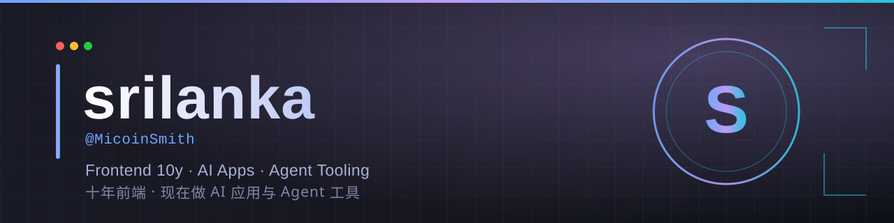

 

 

 

## 👋 About / 关于我

**EN** — Ten years as a frontend engineer, now building AI applications and agent tooling. I like problems that sit between the model and the product: getting an LLM to actually run on hardware nobody supported, wiring an agent skill so a `task_id` turns into a real answer, and shipping the interface that makes it usable.

**中文** — 十年前端工程师，现在做 AI 应用与 Agent 工具。我擅长的是「模型落地到产品」中间那一段：让一个 LLM 跑在没人支持的硬件上、把一个 agent skill 接顺让 `task_id` 变成真结果、再把能用的界面做出来。

💼 **Open to** — AI 应用开发 / 出海接单 / 远程 · **Open to** remote & freelance AI app work

📍 Zhejiang, China · 🌐 [MicoinSmith.github.io](https://MicoinSmith.github.io)

---

## 🛠 Tech Stack

  

---

## 📊 GitHub Stats

 

  

---

## 📈 Metrics

---

## 🏆 Trophies

---

## 🐍 Contribution Snake

<picture>
  <source media="(prefers-color-scheme: dark)" srcset="https://raw.githubusercontent.com/MicoinSmith/MicoinSmith/output/github-snake-dark.svg"/>
  <source media="(prefers-color-scheme: light)" srcset="https://raw.githubusercontent.com/MicoinSmith/MicoinSmith/output/github-snake.svg"/>
  
</picture>

---

## ⭐ Featured Projects

<table>
<tr>
<td width="50%" valign="top">

### 🔥 [rdna2-vllm-rocm7](https://github.com/MicoinSmith/rdna2-vllm-rocm7)

Run **vLLM on RDNA2 (RX 6800/6900 XT)** with ROCm 7.x — prebuilt gfx1030 wheels + reproducible build scripts, cutting a multi-day from-source build down to ~1 hour. *Skips the optional aiter AOT build nobody actually needs.*

`Shell` · `ROCm` · `PyTorch`

</td>
<td width="50%" valign="top">

### 🤖 [Manus-claude-skill](https://github.com/MicoinSmith/Manus-claude-skill)

A **Claude Code plugin** that turns Manus AI's async `task_id` into a real result — create, poll to completion, and retrieve output in one step.

`JavaScript` · `Claude Code` · `Agent`

</td>
</tr>
<tr>
<td width="50%" valign="top">

### 🍎 [Create-macOS-Dmg](https://github.com/MicoinSmith/Create-macOS-Dmg)

macOS installer toolkit — one-command ISO conversion and bootable USB creation, with validation, error handling and colored reporting.

`Shell` · `macOS`

</td>
<td width="50%" valign="top">

### 🧱 [nextScaffold](https://github.com/MicoinSmith/nextScaffold)

Next.js + React scaffold wired with Koa, an express-based mock server, Ant Design, and promise-style axios wrappers.

`JavaScript` · `Next.js` · `Koa`

</td>
</tr>
</table>

<a href="https://github.com/MicoinSmith?tab=repositories&q=&type=source"><b>→ All repositories</b></a>

---

## 🎮 Play Connect4 with me

No clone, no signup. Beat me at Connect4 right here — it's <!-- BEGIN TURN -->yellow<!-- END TURN -->'s turn. Click a column under the board, a pre-filled issue opens, just hit **Create** and the bot plays your move.

<!-- BEGIN CONNECT4 BOARD -->
|   | 1 | 2 | 3 | 4 | 5 | 6 | 7 |   |
|---|:-:|:-:|:-:|:-:|:-:|:-:|:-:|:-:|
|---| |  |  |  |  |  |  | |---|
|---| |  |  |  |  |  |  | |---|
|---| |  |  |  |  |  |  | |---|
|---| |  |  |  |  |  |  | |---|
|---| |  |  |  |  |  |  | |---|
|---| |  |  |  |  |  |  | |---|
|   | [1](https://github.com/MicoinSmith/MicoinSmith/issues/new?body=Please+do+not+change+the+title.+Just+click+%22Submit+new+issue%22.+You+don%27t+need+to+do+anything+else+%3AD&title=Connect4%3A+Put+1) | [2](https://github.com/MicoinSmith/MicoinSmith/issues/new?body=Please+do+not+change+the+title.+Just+click+%22Submit+new+issue%22.+You+don%27t+need+to+do+anything+else+%3AD&title=Connect4%3A+Put+2) | [3](https://github.com/MicoinSmith/MicoinSmith/issues/new?body=Please+do+not+change+the+title.+Just+click+%22Submit+new+issue%22.+You+don%27t+need+to+do+anything+else+%3AD&title=Connect4%3A+Put+3) | [4](https://github.com/MicoinSmith/MicoinSmith/issues/new?body=Please+do+not+change+the+title.+Just+click+%22Submit+new+issue%22.+You+don%27t+need+to+do+anything+else+%3AD&title=Connect4%3A+Put+4) | [5](https://github.com/MicoinSmith/MicoinSmith/issues/new?body=Please+do+not+change+the+title.+Just+click+%22Submit+new+issue%22.+You+don%27t+need+to+do+anything+else+%3AD&title=Connect4%3A+Put+5) | [6](https://github.com/MicoinSmith/MicoinSmith/issues/new?body=Please+do+not+change+the+title.+Just+click+%22Submit+new+issue%22.+You+don%27t+need+to+do+anything+else+%3AD&title=Connect4%3A+Put+6) | [7](https://github.com/MicoinSmith/MicoinSmith/issues/new?body=Please+do+not+change+the+title.+Just+click+%22Submit+new+issue%22.+You+don%27t+need+to+do+anything+else+%3AD&title=Connect4%3A+Put+7) |   |
<!-- END CONNECT4 BOARD -->

<!-- BEGIN MOVES LIST -->
<!-- END MOVES LIST -->

📜 Last 5 moves

<!-- BEGIN LAST MOVES -->
| Move | Author |
| :--: | :----- |
| `Start game` |  [ @MicoinSmith](https://github.com/MicoinSmith) | |
<!-- END LAST MOVES -->

🏅 Top 10 players across all games

<!-- BEGIN TOP MOVES -->
| Total moves |  User  |
| :---------: | :----- |
<!-- END TOP MOVES -->

---

## 🎲 Random / 随机

---

### 📫 Get in touch / 联系我

 

<i>把复杂的事做简单，把模型变成产品。 · Turning models into products people can actually use.</i>

